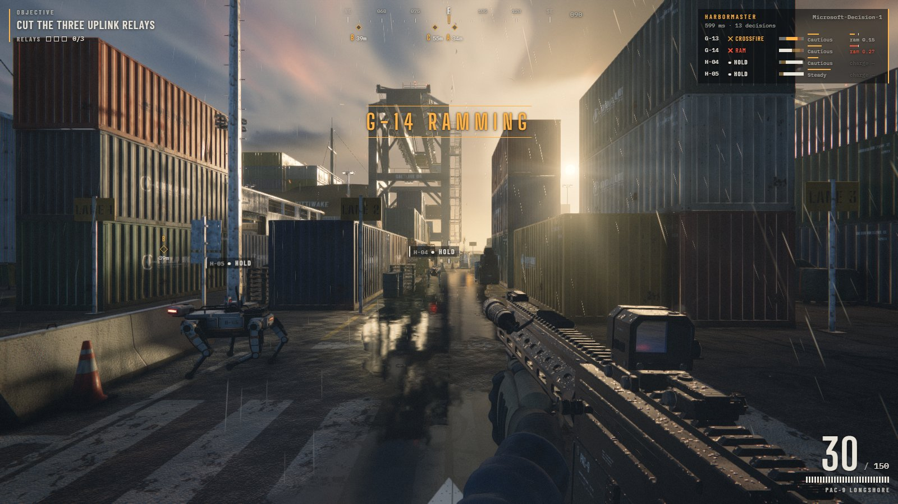
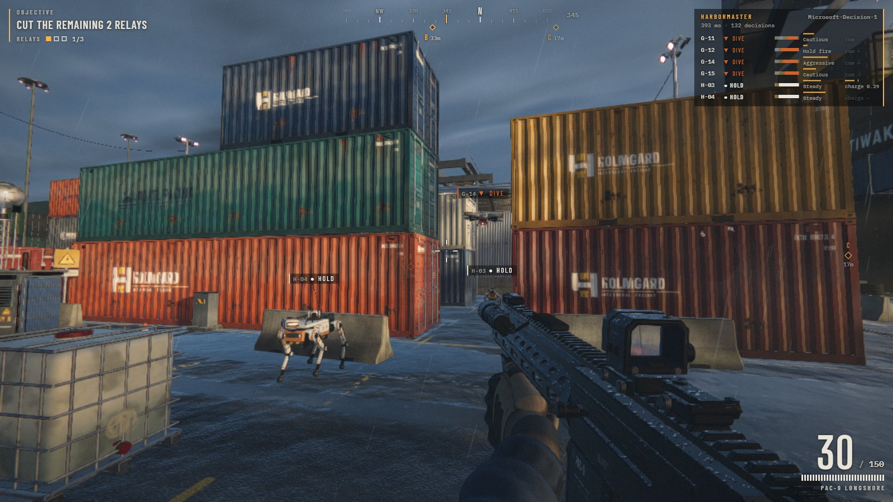
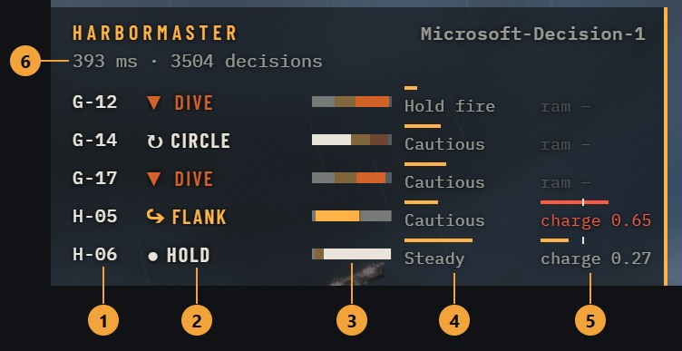
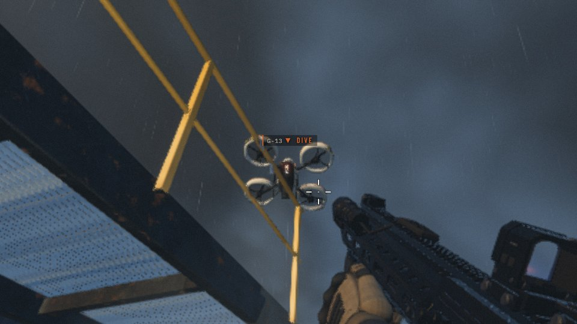
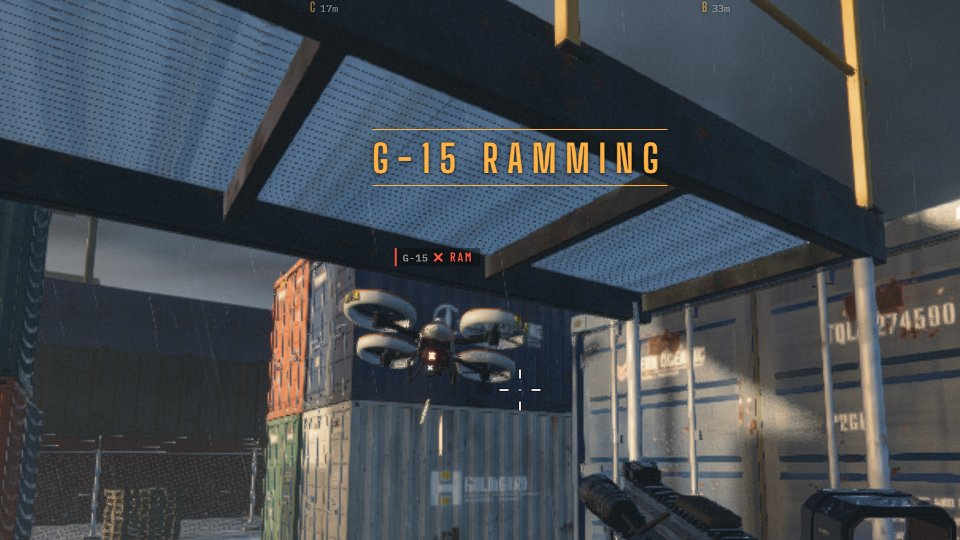
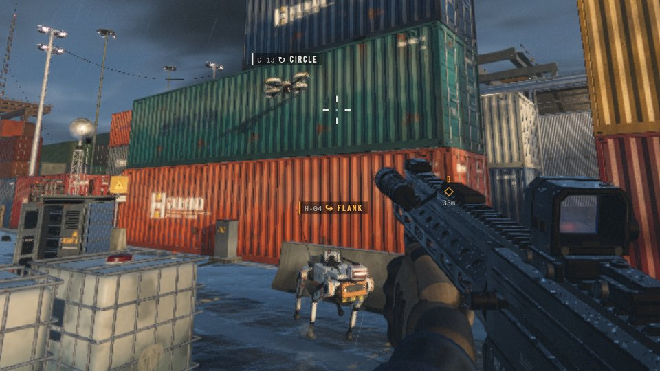
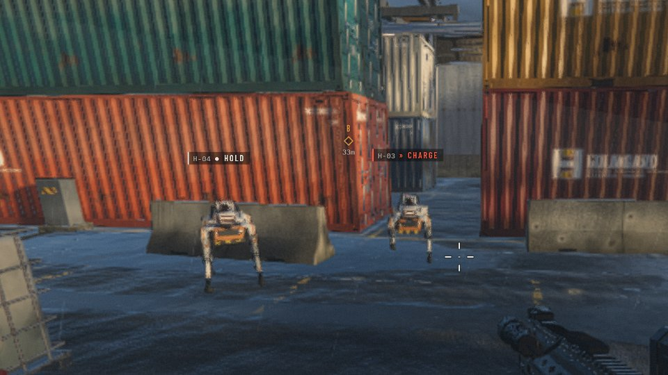

# Saltline — Fable 5.2 FPS, Microsoft-Decision-1 edition

A small browser first-person shooter: one level in a rainy container port. Cut three uplink relays while drones
("Gulls") and robot dogs ("Hounds") hunt you. In this fork, every Gull and Hound that is hunting you decides its next
move with [Microsoft-Decision-1](https://ai.azure.com/catalog/models/Microsoft-Decision-1) on Microsoft Foundry, the
model behind the rivals in [LUNA GP](https://github.com/roryp/racing). The model answers typed questions (`choice`,
`score`, `noul`) with probabilities instead of text.



## Deploy to Azure

One command creates the game's own Microsoft-Decision-1 deployment, hosts the game on App Service and connects the two
with a managed identity. You need the [Azure Developer CLI](https://aka.ms/azd-install) (azd) 1.18+ and an Azure
subscription where you can create resources and assign roles, for example as Owner.

```sh
azd auth login
azd up
```

`azd up` asks for an environment name, a subscription and a region. It only offers regions with enough
Microsoft-Decision-1 quota, and prints the game's URL when it finishes. Everything goes in one resource group:

| Resource | Purpose |
| --- | --- |
| Microsoft Foundry resource with a `decision-1` deployment | Microsoft-Decision-1, GlobalStandard, 1,000 requests a minute. API keys are turned off. |
| User-assigned managed identity | The server's identity. It has the Cognitive Services User role on the Foundry resource, and so do you. |
| App Service plan (Linux, P0v3) and web app | Runs `server.js` on Node 24 LTS with a dedicated vCPU and 4 GB. |

There are no keys or secrets: the server gets Entra ID tokens for its managed identity. A new role assignment can take a
few minutes to apply; until then the machines use the built-in AI.

The P0v3 plan costs about US$57–70 a month, depending on the region, for as long as it exists; the model is billed per
token. In a load test it served about 880 decisions a minute (eight fights) at under 15% CPU. `azd down --purge` deletes
everything.

To change a default, run `azd env set <variable> <value>` and then `azd up` again:

| Variable | Default | Purpose |
| --- | --- | --- |
| `APP_SERVICE_SKU` | `P0v3` | App Service plan size, for example `P1v3` |
| `DECISION_SKU` | `GlobalStandard` | `DataZoneStandard` keeps processing inside the US or EU data zone |
| `DECISION_CAPACITY` | `1000` | Model requests a minute (and thousands of tokens a minute); a fight uses about 110 |

DataZoneStandard quota is shared by all the regions in a data zone, so another Microsoft-Decision-1 deployment in the
same subscription may already be using it up.

## Run it locally

Requires Node.js 20.12+ and the Azure CLI signed in (`az login`) with access to a Microsoft-Decision-1 deployment.
There are no npm dependencies.

```sh
azd env get-values > .env   # after azd up; or copy .env.example and set FOUNDRY_ENDPOINT to your own Foundry resource
npm start
```

In Windows PowerShell 5.1, `>` writes UTF-16, which Node can't read: use `azd env get-values | Set-Content .env` there.

Open <http://127.0.0.1:8731>, or the URL `azd up` printed, and click the page to capture the mouse and start the sound.
Press **T** to cycle the AI tags and the Harbormaster panel.

Without `FOUNDRY_ENDPOINT`, or from a plain static server (`python3 -m http.server 8731`), the Gulls and Hounds use the
game's built-in AI.

## Play

Cut the three uplink relays (A, B and C on the compass), then get to the extraction boat. Each relay you cut sends in a
bigger wave, up to nine machines at once.

**WASD** move, **mouse** look, **left button** fire, **right button** aim, **R** reload, **hold E** cut a relay,
**Shift** sprint, **C** or **Ctrl** crouch, **Space** jump, **F** melee, **Esc** or **P** pause, **T** AI tags and
panel. Touch screens and gamepads work too: see **Controls** on the title screen.

## Read the live overlay



The overlay shows what Microsoft-Decision-1 last told each machine, and every machine that is hunting you asks again
every 1.3–2.1 s. **T** cycles it: tags and panel, tags only, off.

**Tags** float over each machine that is hunting you and that you can see, so they never give away a machine behind a
wall. A tag shows the machine's ID and its order. It fades and says "hold fire" when the model has told the machine not
to shoot, and it pulses red for the two drastic moves, ✖︎ Ram and » Charge.

**The Harbormaster panel** lists every machine that is hunting you, including the ones you can't see, with the model's
latest answer:



1. **Machine**: the ID painted on it. Gulls are G-11 and up, Hounds H-03 and up.
2. **Order**: the `choice` answer, the machine's job for the next few seconds.
3. **Odds**: one segment per possible order, as wide as its probability. The solid one won; an even split means the
   model was torn.
4. **Aggression**: the `score` answer, from Hold fire through Cautious, Steady and Aggressive to Relentless. The line
   above it shows the score out of 4.
5. **Ram or charge**: the `noul` answer, the probability that this Gull should ram you or this Hound should charge. The
   tick marks the threshold (0.25 to ram, 0.4 to charge), and red means the answer is over it. A dash means the
   question wasn't asked: a Gull is only asked at half hull or less with you in sight within 30 m, a Hound only with
   you in sight within 16 m.
6. **Status**: the model's average response time and the decisions so far, or "built-in AI" when the model can't be
   reached.

Here H-05's last answer put a charge at 0.65, over the threshold.

## How to fight the machines

Read a machine's tag and answer its order:

| Tag | Who | What it does | What to do |
| --- | --- | --- | --- |
| ▼ Dive | Gull | Drops to about 9 m out and 2.5 m up for accurate fire | Shoot it now: it is close, low and exposed |
| ▲ Climb | Gull | Climbs to about 10 m up and 24 m out, where its fire is less accurate | Deal with closer threats first |
| ↻ Circle | Gull | Orbits about 18 m out, swinging round towards your back | Keep turning with it |
| ✕&nbsp;Crossfire | Both | Moves to your side opposite the rest of the squad | Back off until every machine is in front of you |
| ■ Cover | Hound | Fires from a spot behind cover 8–18 m away | Aim for the head, which shows over low cover |
| ● Hold | Hound | Stands still and fires three bursts before it moves | Line up head shots, or break line of sight |
| ↪︎ Flank | Hound | Works round to your side or back, out of your sight | Check the panel: a Flank you can't see is coming round behind you |
| ▽&nbsp;Fall&nbsp;back | Hound | Backs off to 15–26 m, behind cover if it can | It is less accurate out there: deal with the others first |
| ✖︎ Ram | Gull | Flies into you and explodes for up to 30 damage | Shoot it: one hit brings it down |
| » Charge | Hound | Sprints in to bite for 15 damage, three times a gun round | Back off and aim for the head |

|  |  |
| --- | --- |
| **Dive**: G-13 drops in close under a gantry. It is easy to hit there, and two hits bring it down. | **Ram**: G-15 is at 42% hull when the model says ram (0.27 against 0.25). One hit stops it. |
|  |  |
| **Flank**: H-04 works round a barrier while G-13 circles overhead. | **Charge**: H-03 sprints in (0.50 against 0.4) while H-04 holds behind a barrier. |

- **Gulls die in two hits, Hounds in six, or three to the head.** Your rifle does 26 a hit at any range. A Gull has 45
  hull and a Hound 140 armor, and head hits on a Hound do 2.2 times the damage.
- **Finish damaged Gulls first.** Only a Gull at half hull or less can ram, and one hit downs it.
- **Shot-down Gulls explode where they crash**, for up to 15 damage to you within 3 m and up to 30 to any machine
  there.
- **Watch the aggression.** A Relentless machine fires about twice as fast as a Steady one, and a "hold fire" machine
  doesn't fire at all.
- **They know what you are doing.** Every decision is told your health, whether you are reloading, sprinting, crouched
  or aiming, and where you are looking. Reload behind cover.
- **A charge is one bite.** After it, the Hound can't charge again for 6 s.

## How the machines use Microsoft-Decision-1

| Who | When | Questions |
| --- | --- | --- |
| **Each Gull** (drone) | Every 1.3–2.1 s while it hunts you | `choice` maneuver, `score` aggression, `noul` ram you? |
| **Each Hound** (robot dog) | Every 1.3–2.1 s while it hunts you | `choice` tactic, `score` aggression, `noul` charge? |

Each request describes the situation from that machine's point of view: its hull, range and height, whether it can see
you and where you are looking, your health and what you are doing (reloading, sprinting, aiming), the orders of the rest
of the squad, and how many relays you have cut. The game's own AI still flies, walks, aims and shoots; the answers steer
it:

| Answer | Effect |
| --- | --- |
| Gull maneuver: `circle`, `crossfire`, `dive`, `climb` | Orbit radius, altitude and direction round you |
| Hound tactic: `cover`, `flank`, `crossfire`, `hold`, `fall_back` | Where the Hound picks its next firing spot |
| Aggression: 0 Hold fire … 4 Relentless | Fire rate; below 0.5 the machine holds fire |
| Ram, asked when a Gull is at half hull or less | p ≥ 0.25: the Gull dives into you and self-destructs |
| Charge, asked when a Hound sees you within 16 m | p ≥ 0.4: the Hound sprints in to bite, at most every 6 s |

The ram and charge thresholds sit below 0.5 because the model is cautious about drastic moves. A decision is about 500
input tokens, and a fight with five machines makes about 110 calls a minute. If a call fails, that machine falls back to
the built-in AI until the next answer.

The [live overlay](#read-the-live-overlay) shows every answer as it arrives.

## Configuration

| Variable | Default | Purpose |
| --- | --- | --- |
| `FOUNDRY_ENDPOINT` | – | Foundry resource endpoint (required for model decisions) |
| `FOUNDRY_DEPLOYMENT` | `decision-1` | Model deployment name |
| `FOUNDRY_API_KEY` | unset | Optional key auth; otherwise Entra ID: the App Service managed identity, else the Azure CLI login |
| `AZURE_CLIENT_ID` | unset | Client ID of the user-assigned managed identity to use on App Service |
| `PORT` / `HOST` | `8731` / `127.0.0.1` | Listen address |
| `DAILY_CALL_LIMIT` | `20000` | Most model calls per UTC day |
| `LOG_DECISIONS` | unset | `1` logs every decision |

The server also reads these from a git-ignored `.env` file next to `server.js`; real environment variables win. On App
Service, `azd` sets `FOUNDRY_ENDPOINT`, `FOUNDRY_DEPLOYMENT`, `AZURE_CLIENT_ID` and `HOST`, and `.webappignore` keeps
your local `.env` out of the deployment.

## Tests

`npm test` runs the node:test suites; they make no model calls.

## Where it comes from

- Built by **Claude Fable 5.2**. The run was set up by Felix Rieseberg (Anthropic) and shared on X on 2026-11-09:
  https://x.com/felixrieseberg/status/2119925633564463609
- Original playable artifact: https://claude.ai/artifact/BGY1SztrAYcJQHSsnHHGmp
- Per his post: one prompt, no human feedback, about 8 hours, about 2.7M output and 445M input tokens (heavily cached), about $550 at API pricing. Models, sounds and textures are all made in code. These numbers are his own and not checked here.

All credit for the game goes to its original author. The upstream repo mirrors the artifact so people can run it
locally; this fork adds the Microsoft-Decision-1 brain for the Gulls and Hounds. If you are the author and want it taken
down, open an issue.

Original demo, with the built-in AI: https://realcodebear.github.io/saltline-fable-5.2/

## What changed from the artifact

- The claude.ai frame-runtime scripts were removed from `<head>`, and a doctype, charset and viewport tag were added so
  the file runs as a plain web page.
- `index.html` loads `css/harbormaster.css` and `js/harbormaster.js`, and has three small hooks in the Hound code. Each
  does nothing without the brain:
  - the Hound's firing-spot picker asks `brain.firePos` first, so the model's tactic picks the spot;
  - Hounds have a `_replan()` method, so a new tactic takes effect at once;
  - `burstsWanted` sets how many bursts a Hound fires before it moves.
- Everything else is new: the server (`server.js`, `lib/`), the brain (`js/`), its styles (`css/`), the tests
  (`test/`) and the Azure deployment (`azure.yaml`, `infra/`).

The game itself is still one file, `index.html` (~1.4 MB). It bundles three.js and loads fonts from Google Fonts. There
are no other outside assets.
